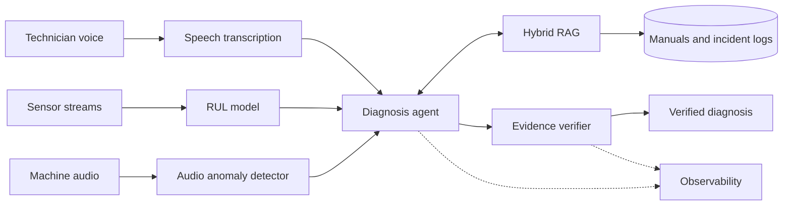

# MAINTAIN-X

> An evidence-driven multimodal AI platform for industrial maintenance.

MAINTAIN-X helps technicians diagnose industrial equipment failures. It combines
predictive maintenance, speech AI, acoustic anomaly detection, hybrid
retrieval-augmented generation, and an agentic workflow. Every diagnosis is
backed by evidence and verified before it reaches the technician.


## Table of Contents

- [Overview](#overview)
- [Features](#features)
- [Architecture](#architecture)
- [Results](#results)
- [Tech Stack](#tech-stack)
- [Repository Layout](#repository-layout)
- [Getting Started](#getting-started)
- [Usage](#usage)
- [Evaluation](#evaluation)
- [Observability](#observability)
- [Roadmap](#roadmap)
- [License](#license)

## Overview

A technician describes a problem by voice. MAINTAIN-X transcribes the report,
checks the machine's sensor and audio signals, retrieves relevant maintenance
manuals and past incidents, and produces a diagnosis. An evidence-verification
step then checks each claim against its sources before the answer is returned.

## Features

| Capability | Description |
|---|---|
| **Predictive maintenance** | Remaining Useful Life (RUL) prediction for turbofan engines on NASA C-MAPSS FD001 |
| **Time-series forecasting** | Sensor trajectory forecasting and degradation trend analysis |
| **Audio anomaly detection** | Detects abnormal machine sounds from industrial audio |
| **Speech transcription** | Converts technician voice reports into structured text |
| **Hybrid RAG** | Dense plus keyword retrieval over manuals and incident logs, with reranking |
| **Agentic diagnosis** | A tool-using agent that combines RUL, anomaly, and retrieval outputs |
| **Evidence verification** | Checks every diagnostic claim against retrieved sources and flags unsupported ones |
| **AI evaluation** | Offline metrics for the predictive models, retrieval, and the agent |
| **LLM observability** | Tracing, latency, cost, and quality monitoring |

## Architecture



## Results

RUL prediction on C-MAPSS FD001 test set (last cycle per engine):

| Model | RMSE | MAE | NASA score |
|---|---|---|---|
| Linear Regression | _TBD_ | _TBD_ | _TBD_ |
| Random Forest | _TBD_ | _TBD_ | _TBD_ |
| XGBoost | _TBD_ | _TBD_ | _TBD_ |

Fill in the numbers from your MLflow runs. Lower is better for all three metrics.

## Tech Stack

- **ML / data:** Python, pandas, Parquet, scikit-learn, XGBoost
- **Speech:** _e.g. Whisper_
- **Retrieval and LLM:** _e.g. vector store + BM25, reranker, LLM provider_
- **Serving:** _e.g. FastAPI_
- **Experiment tracking:** MLflow (PostgreSQL metadata, MinIO artifacts)
- **Infrastructure:** Docker and Docker Compose
- **Training:** Google Colab with Google Drive for artifact persistence

## Repository Layout

```
maintain-x/
├── src/maintainx/
│   ├── features/      # config, selection, rolling, temporal, target, pipeline
│   ├── evaluation/    # RMSE, MAE, NASA score, retrieval and agent evals
│   ├── models/        # one training module per model + shared utils
│   ├── tracking/      # MLflow helpers
│   ├── audio/         # anomaly detection
│   ├── speech/        # transcription
│   ├── rag/           # ingestion, hybrid retrieval, reranking
│   ├── agent/         # diagnosis agent and tools
│   ├── verification/  # evidence verification
│   └── api/           # serving layer
├── notebooks/         # thin drivers; logic lives in the package
├── scripts/           # utilities (e.g. MLflow smoke test)
├── data/              # raw and processed data (see data/README.md)
├── docker-compose.yml
├── Dockerfile.mlflow
└── tests/
```

## Getting Started

### Prerequisites

- Python 3.11+
- Docker and Docker Compose

### Installation

```bash
git clone https://github.com/<your-username>/maintain-x.git
cd maintain-x
python -m venv .venv
source .venv/bin/activate      # Windows: .venv\Scripts\Activate.ps1
pip install -e .
```

### Data

The C-MAPSS dataset is downloaded manually and preprocessed locally. See
[`data/README.md`](data/README.md). Processed files are written to
`data/processed/FD001/`.

### Start the infrastructure

```bash
docker compose up -d
```

This starts PostgreSQL, MinIO, and MLflow. The MLflow UI is at
http://localhost:5000.

## Usage

Train a model (each model has its own training module):

```bash
python -m maintainx.models.train_xgboost
```

Start the API:

```bash
uvicorn maintainx.api.main:app --reload
```

Request a diagnosis:

```bash
curl -X POST http://localhost:8000/diagnose \
  -F "audio=@report.wav" \
  -F "unit_id=42"
```

## Evaluation

- **RUL:** RMSE, MAE, and the asymmetric NASA scoring function, which penalizes
  late predictions more than early ones.
- **Retrieval:** recall@k and MRR on a labeled set of maintenance queries.
- **Agent:** diagnosis accuracy and tool-use correctness.
- **Verification:** share of claims supported by cited evidence.

Run the test suite, including the feature-leakage tests:

```bash
pytest
```

## Observability

LLM calls and agent steps are traced with latency, token usage, and cost.
Experiment runs are tracked in MLflow.

## Roadmap

- [x] Predictive maintenance on FD001
- [x] Audio anomaly detection
- [x] Speech transcription
- [x] Hybrid RAG
- [x] Agentic diagnosis and evidence verification
- [x] Evaluation and observability
- [ ] Extend to FD002–FD004
- [ ] Edge deployment

## License

MIT
